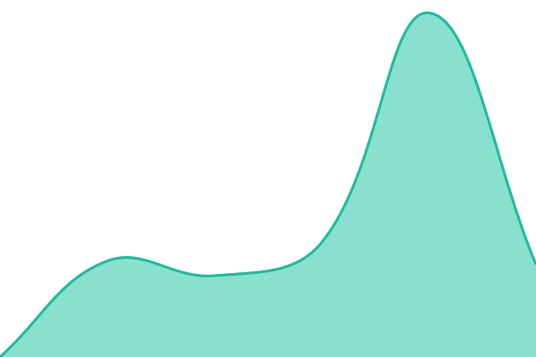
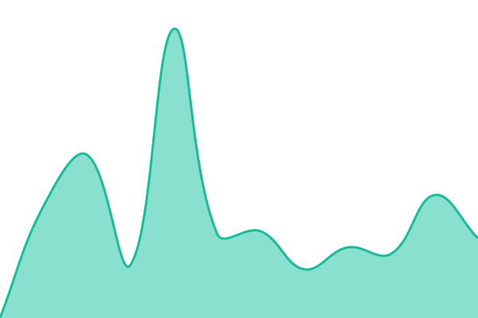

# Статус сервисов Anamnez

This repository contains the open-source uptime monitor and status page for [Ko8a](https://status.anamnez.kz), powered by [Upptime](https://github.com/upptime/upptime).

<!--live status--> **🟩 All systems operational**

<!--start: status pages-->
<!-- This summary is generated by Upptime (https://github.com/upptime/upptime) -->
<!-- Do not edit this manually, your changes will be overwritten -->
<!-- prettier-ignore -->
| URL | Status | History | Response Time | Uptime |
| --- | ------ | ------- | ------------- | ------ |
|  [Приложение для врачей](https://app.anamnez.kz) | 🟩 Up | [prilozhenie-dlya-vrachej.yml](https://github.com/Ko8a/anamnez-status/commits/HEAD/history/prilozhenie-dlya-vrachej.yml) | 

 3183ms
     
 | 

<a href="https://status.anamnez.kz/history/prilozhenie-dlya-vrachej">100.00%</a>
    

|  [API](https://app.anamnez.kz/api/v1/health) | 🟩 Up | [api.yml](https://github.com/Ko8a/anamnez-status/commits/HEAD/history/api.yml) | 

 1685ms
     
 | 

<a href="https://status.anamnez.kz/history/api">100.00%</a>
    

|  [ИИ (анамнез, Copilot, распознавание речи)](https://app.anamnez.kz/api/v1/health/ai) | 🟩 Up | [ii-anamnez-copilot-raspoznavanie-rechi.yml](https://github.com/Ko8a/anamnez-status/commits/HEAD/history/ii-anamnez-copilot-raspoznavanie-rechi.yml) | 

 1188ms
     
 | 

<a href="https://status.anamnez.kz/history/ii-anamnez-copilot-raspoznavanie-rechi">99.93%</a>
    

|  [Сайт anamnez.kz](https://www.anamnez.kz) | 🟩 Up | [sajt-anamnez-kz.yml](https://github.com/Ko8a/anamnez-status/commits/HEAD/history/sajt-anamnez-kz.yml) | 

 805ms
     
 | 

<a href="https://status.anamnez.kz/history/sajt-anamnez-kz">100.00%</a>
    

<!--end: status pages-->

[**Visit our status website →**](https://status.anamnez.kz)
